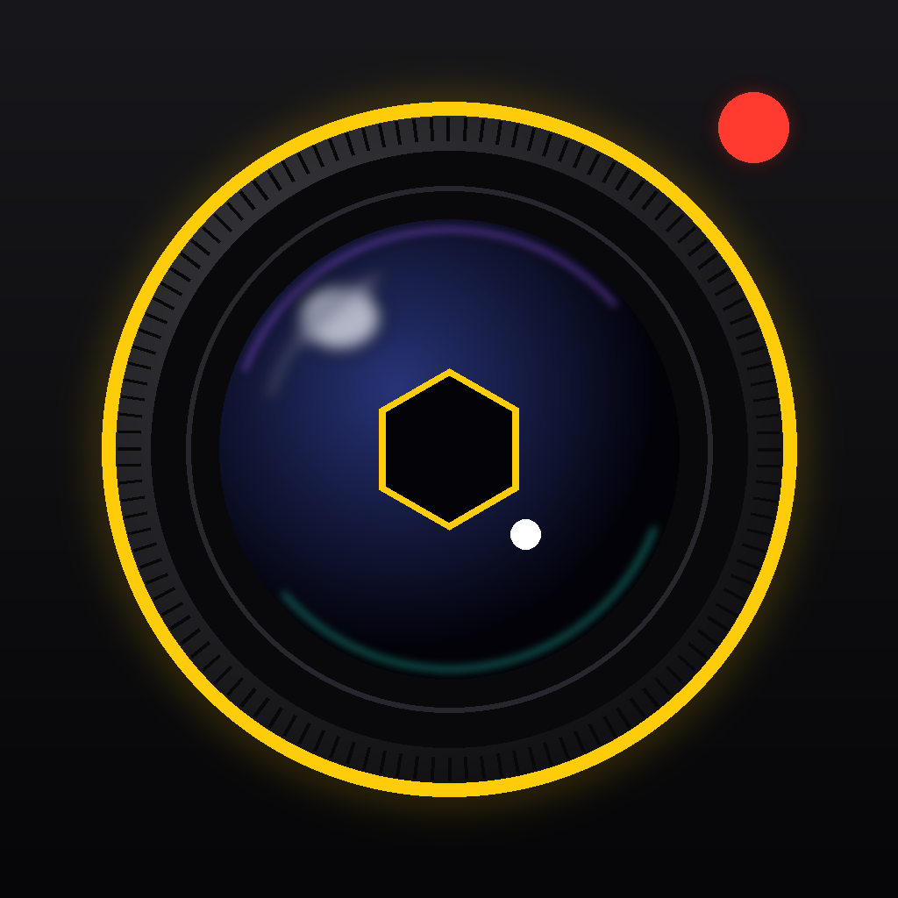

# 📸 Shakil Cam

App fotocamera **pro** per iPhone, scritta in SwiftUI + AVFoundation.
Controlli manuali, **Apple Log**, strumenti da cinema (istogramma, zebra, focus peaking, falsi colori, LUT),
un **log live** di tutto quello che fa la fotocamera e un'interfaccia scura in stile cinepresa.

<p align="center">
  
</p>

---

## ✨ Funzioni

### Scatto
| | |
|---|---|
| **FOTO / VIDEO** | Tocca la modalità o scorri sopra le scritte |
| **Obiettivi .5 / 1 / 3 (5)** | Cambia obiettivo fisico (ultra grandangolo, principale, tele) + fotocamera frontale |
| **Zoom** | Pizzica lo schermo o usa la ghiera |
| **Tasti volume / tasto Fotocamera** | Funzionano come pulsante di scatto (iOS 17.2+). Su iPhone 16+ il tasto Fotocamera controlla anche zoom ed esposizione |
| **Autoscatto** | 3 o 10 secondi, con conto alla rovescia a schermo |
| **Flash / Torcia** | Off · Auto · On nelle foto, torcia continua nei video |

### Controlli manuali (ghiere a scorrimento con feedback aptico)
- **EV** – compensazione dell'esposizione
- **ISO** – sensibilità, con **esposimetro** che indica quanto sei sopra/sotto
- **Shutter** – tempo di scatto, con **angolo otturatore** e pulsante **180°** per i video
- **WB** – bilanciamento del bianco in Kelvin + preset (tungsteno, neon, sole, nuvoloso, ombra)
- **Focus** – messa a fuoco manuale (con scorciatoia per il focus peaking)
- **AUTO** – riporta tutto in automatico. Ogni chip mostra **A** (auto) o **M** (manuale)
- **Tap** sul mirino = fuoco + esposizione su quel punto · **Tieni premuto** = blocco AE/AF

### Video pro
- **4K / 1080p / 720p** a **24 · 25 · 30 · 48 · 50 · 60 · 120 · 240 fps** (secondo il tuo iPhone)
- Profili colore **SDR Rec.709**, **HDR HLG** e **Apple Log** (iPhone 15 Pro e successivi)
- Codec **HEVC**, **H.264**, **ProRes** (sui modelli Pro)
- Stabilizzazione **Standard / Cinema / Cinema+**
- **Timecode** HH:MM:SS:FF, **audio meter**, minuti di registrazione rimasti, batteria, temperatura
- Le combinazioni non supportate vengono adattate da sole (e scritte nel log)

### Foto pro
- **HEIF**, **JPEG**, **RAW (DNG + HEIF)**, **Apple ProRAW**
- Risoluzione **12 MP** o **MAX** (fino a 48 MP), colori **Display P3**
- **Look** cinematografici (Teal & Orange, Pellicola, Noir, Bleach, Notte Blu) salvati nelle foto

### Strumenti mirino
- **Istogramma** Luma / RGB con indicatori di clipping
- **Zebra** con soglia regolabile (70–100%)
- **Focus peaking** in 4 colori
- **Falsi colori** con legenda (nero, basse, 18%, pelle, alte, clip)
- **LUT Log → Rec.709**: vedi l'Apple Log a colori normali mentre il file resta Log
- **Griglia** (terzi, aurea, centro), **livella** dell'orizzonte, **guide di formato** (2.39:1, 1.85:1, 1:1, 4:5, 9:16)

### Log
- **Console live** sul mirino con gli ultimi eventi (formati, cambi obiettivo, scatti, errori…)
- **Impostazioni → Log della fotocamera**: cronologia completa, filtri (Tutto / Scatti / Problemi), copia e condivisione

### Altro
- **Galleria** della sessione con metadati (ISO, tempo, apertura, focale, formato) e condivisione
- Tutto viene salvato anche nell'app **Foto**
- **Guida** integrata che spiega ogni pulsante in italiano
- **Info fotocamera**: capacità reali di ogni obiettivo del tuo iPhone

---

## 🚀 Come installarla sul tuo iPhone

Serve un **Mac con Xcode 16 o successivo** e un **iPhone con iOS 17 o successivo**.
La fotocamera non funziona nel Simulatore: va provata su un iPhone vero.

1. Scarica il progetto (`git clone` oppure *Code → Download ZIP*).
2. Apri **`ShakilCam.xcodeproj`** con Xcode.
3. Nel pannello a sinistra clicca sul progetto **ShakilCam** → target **ShakilCam** → scheda **Signing & Capabilities**:
   - in **Team** scegli il tuo Apple ID (va bene anche un account gratuito);
   - se Xcode segnala che il *Bundle Identifier* è già in uso, cambialo (es. `com.tuonome.shakilcam`).
4. Collega l'iPhone, selezionalo in alto come destinazione e premi **▶︎ Run**.
5. Sull'iPhone, la prima volta: *Impostazioni → Generali → VPN e gestione dispositivi* → autorizza il tuo sviluppatore.
6. Concedi l'accesso a fotocamera, microfono e Foto quando richiesto.

> Con un account Apple gratuito l'app resta installata per 7 giorni, poi basta rifare *Run* da Xcode.

---

## 🧱 Struttura del codice

```
ShakilCam/
├── App/            Punto di ingresso SwiftUI
├── Camera/         Sessione AVFoundation, controlli manuali, scatto/registrazione,
│                   log eventi, sensori di movimento, salvataggio in Foto
├── Processing/     Pipeline Core Image + Metal: LUT Apple Log, look, peaking,
│                   zebra, falsi colori, istogramma
└── Views/          Interfaccia: mirino e overlay, ghiere, impostazioni,
                    strumenti, galleria, guida
```

Note tecniche:
- Il mirino usa `AVCaptureVideoPreviewLayer` e passa a un render **Metal + Core Image** solo quando serve
  un'elaborazione (LUT, look, peaking, zebra, falsi colori), così la batteria dura di più.
- La LUT Apple Log → Rec.709 e i look sono generati nel codice (cubi 33³), senza file esterni.
- Con **ProRes** iOS non permette di analizzare i fotogrammi in parallelo alla registrazione:
  in quel caso gli strumenti di analisi vengono messi in pausa e l'app lo segnala.
